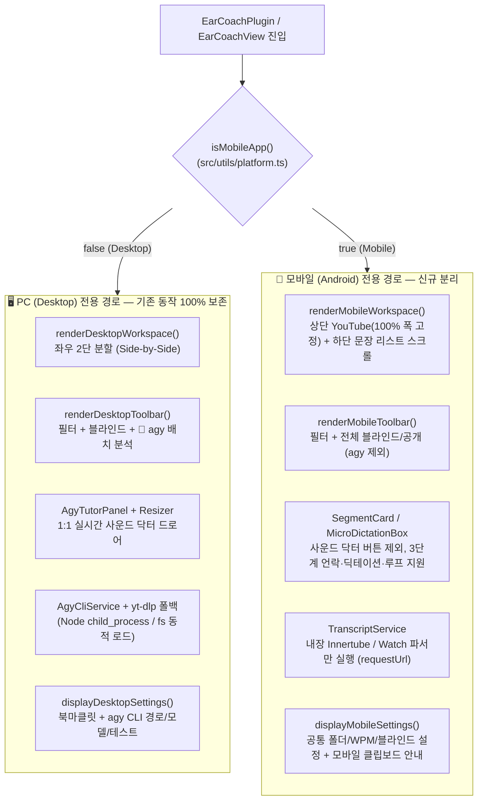

# 📱 Obsidian Ear-Coach 모바일(안드로이드) 지원 및 PC 완벽 분리 구현 계획서

> [!IMPORTANT]
> 본 계획서는 **기존 PC(데스크톱) 버전의 동작과 레이아웃에 0%의 영향(Zero Regression)**을 보장하면서, **안드로이드 모바일 환경에서 `agy` CLI/사운드 닥터를 제외한 모든 기능과 모바일 전용 상단 고정 플레이어 + 하단 문장 스크롤 레이아웃**을 지원하는 상세 설계서입니다.  
> 형님께서 계획서를 검토하신 후 **Proceed** 버튼을 눌러주시면 그때부터 코딩을 시작합니다.

---

## 1. 핵심 설계 원칙 (PC 버전 무결성 100% 보장)

1. **PC / 모바일 실행 경로 및 렌더 함수 완전 분리**:
   - 공통 진입점에서 `isMobileApp()` / `isDesktopApp()` (`src/utils/platform.ts`)으로 분기하여, **PC 버전은 기존의 함수, DOM 트리, CSS 클래스를 단 1줄의 변경 없이 그대로 실행**합니다.
   - 하나의 컴포넌트 안에서 동작이 달라져야 하는 경우, 조건문을 덕지덕지 섞지 않고 **`renderDesktop*()` 함수와 `renderMobile*()` 함수로 명확히 분리**합니다.
2. **Node.js 전용 모듈 지연 로드 (모바일 크래시 원천 차단)**:
   - 안드로이드 Obsidian(Capacitor WebView)에서 `main.js` 로드 시 `child_process`, `fs/promises`, `path`, `os`, `util` 정적 `import` 때문에 플러그인 자체가 켜지지 않는 문제를 해결하기 위해, 정적 값 `import`를 제거(`import type`만 유지)하고 데스크톱 전용 헬퍼(`requireDesktopNodeModule`)를 통해서만 로드합니다.
3. **모바일 전용 상단 고정 유튜브 + 하단 문장 스크롤 레이아웃**:
   - 모바일에서는 화면이 세로로 길기 때문에 좌우 분할(Side-by-Side) 대신:
     1. **상단 고정 영역 (`.ear-coach-mobile-top-player`)**: 부모 너비(`width: 100%`, 16:9 비율)에 맞춰 YouTube 플레이어와 재생/루프/배속 컨트롤 바를 상단에 고정 배치합니다.
     2. **중단 고정 툴바 (`.ear-coach-mobile-toolbar`)**: 필터(전체 / 안 들림 핀 / 과속 구간) 및 전체 블라인드/전체 공개 버튼을 컴팩트하게 배치합니다 (`agy` 배치 분석 버튼 제외).
     3. **하단 독립 스크롤 리스트 (`.ear-coach-mobile-list-wrapper`)**: 남은 세로 영역(`flex: 1 1 0; min-height: 0; overflow-y: auto`)에서 문장별 카드 리스트(`VirtualSegmentList`)만 부드럽게 가상 스크롤됩니다.
4. **Zero-Blur 및 파일 크기 제한(900줄 미만) 엄수**:
   - 모든 신규/수정 CSS에서도 `backdrop-filter: blur`를 일절 사용하지 않으며, 모든 파일이 900줄을 넘지 않도록 모듈을 작게 유지합니다.

---

## 2. 아키텍처 및 플랫폼 분기 구조

---

## 3. 파일별 상세 수정 및 신규 추가 계획

### Phase 1: 플랫폼 감지 및 Node.js 지연 로더 신설 (`src/utils/platform.ts`)
- **[신규] [platform.ts](file:///k:/Antigravity_Projects/gitbase/happynote2/src/utils/platform.ts)** (약 60줄)
  - `isMobileApp(): boolean`: Obsidian `Platform.isMobile`을 반환 (Node 테스트 환경에서는 `false` 안전 폴백).
  - `isDesktopApp(): boolean`: `!isMobileApp()` 반환.
  - `requireDesktopModule<T>(moduleId: string): T`: 데스크톱 환경에서만 `window.require` 또는 전역 `require`를 통해 `child_process`, `fs/promises`, `path`, `os`, `util`을 로드. 모바일에서 호출 시 즉시 명확한 에러를 던져 크래시 방지.

### Phase 2: 서비스 레이어 Node.js 정적 의존성 제거 (PC 동작 100% 동일 유지)
- **[수정] [AgyCliService.ts](file:///k:/Antigravity_Projects/gitbase/happynote2/src/services/AgyCliService.ts)** (현재 308줄)
  - 최상단의 `import { spawn, execFile } from "child_process"` 및 `import { promisify } from "util"`을 제거하고 `import type { ChildProcessWithoutNullStreams } from "child_process"`만 유지.
  - 내부 `getDesktopChildProcess()` 헬퍼 함수를 통해 데스크톱에서만 `spawn`, `execFileAsync`를 로드.
  - 모바일(`isMobileApp()`)에서 호출될 경우 `checkAgyAvailable()`은 즉시 `false`를 반환.
- **[수정] [TranscriptService.ts](file:///k:/Antigravity_Projects/gitbase/happynote2/src/services/TranscriptService.ts)** (현재 409줄)
  - 최상단의 `child_process`, `util`, `fs/promises`, `path`, `os` 정적 import를 제거.
  - `fetchTranscript()`에서:
    - 1순위 `fetchViaBuiltInExtractor()`(Obsidian `requestUrl` 기반 Android Innertube + Watch Page 파서)는 PC와 모바일 모두 동일하게 실행.
    - 1순위 실패 시 `isDesktopApp()`일 때만 2순위 `fetchViaYtDlpFallback()`(내부에서 `fs/promises`, `path`, `os`, `child_process` 동적 로드)을 실행하고, 모바일에서는 즉시 원래 에러를 반환.

### Phase 3: 워크스페이스 뷰 & UI 컴포넌트 PC / 모바일 함수 분리
- **[수정] [EarCoachView.ts](file:///k:/Antigravity_Projects/gitbase/happynote2/src/ui/EarCoachView.ts)** (현재 461줄 → 약 520줄)
  - `renderWorkspace()`에서 `isMobileApp()` 여부에 따라:
    - **PC**: `renderDesktopWorkspace(root)` 호출 → 기존의 `.ear-coach-side-by-side-container` (좌측 `transcript-column` + `AgyTutorPanel` 리사이저 드로어 / 우측 `video-column`) 코드를 **그대로 실행**.
    - **모바일**: `renderMobileWorkspace(root)` 호출 → `.ear-coach-mobile-container` 내부에:
      1. **상단 고정 비디오 헤더 (`.ear-coach-mobile-top-player`)**: `PlayerBar` 마운트 (`width: 100%` 고정).
      2. **중단 고정 툴바 (`.ear-coach-mobile-toolbar`)**: `renderMobileToolbar()` 호출 (필터 버튼 + 전체 블라인드/전체 공개 버튼만 렌더링, `agy` 배치 분석 버튼 제외).
      3. **하단 스크롤 리스트 래퍼 (`.ear-coach-mobile-list-wrapper`)**: `VirtualSegmentList` 마운트 (문장 리스트만 독자 스크롤, `AgyTutorPanel` 및 리사이저는 아예 생성하지 않음).
  - 툴바 렌더링 함수도 `renderDesktopToolbar(toolbar)`와 `renderMobileToolbar(toolbar)`로 명확히 분리.
- **[수정] [SegmentCard.ts](file:///k:/Antigravity_Projects/gitbase/happynote2/src/ui/components/SegmentCard.ts)** (현재 221줄)
  - `renderStepBar()`에서 데스크톱(`isDesktopApp()`)일 때만 `🎙️ 1:1 사운드 해부` 버튼을 렌더링하는 `renderDesktopTutorTrigger(stepBar)`를 호출하고, 모바일에서는 생략. (단, PC에서 이미 저장해 둔 `tutorNotes`나 `analysis` 힌트/배지는 모바일에서도 그대로 열람 가능!)
- **[수정] [MicroDictationBox.ts](file:///k:/Antigravity_Projects/gitbase/happynote2/src/ui/components/MicroDictationBox.ts)** (현재 122줄)
  - 하단 발음 메모 영역을 `renderDesktopHeardRow()`(내 귀에 들린 발음 입력 + `🎙️ 왜 이렇게 들리는지 agy에게 묻기` 버튼)와 `renderMobileHeardRow()`(내 귀에 들린 발음 셀프 메모 입력창만 제공)로 함수 분리.
- **[수정] [SettingsTab.ts](file:///k:/Antigravity_Projects/gitbase/happynote2/src/ui/SettingsTab.ts)** (현재 159줄)
  - `display()` 내부를 `displayCommonSettings(containerEl)`, `displayDesktopOnlySettings(containerEl)`, `displayMobileGuideBanner(containerEl)` 함수로 분리하여 PC 설정 화면은 기존과 100% 동일하게 유지하고, 모바일에서는 불필요한 `agy` CLI 경로/북마클릿 설정 대신 모바일 사용 안내와 공통 설정만 깔끔하게 노출.
- **[수정] [main.ts](file:///k:/Antigravity_Projects/gitbase/happynote2/src/main.ts)** (현재 530줄)
  - `handleYouTubeTrigger()`에서 `if (isDesktopApp() && this.settings.autoRunAgyBatchOnCreate)` 가드를 적용하여 모바일에서는 `agy` 백그라운드 배치 분석을 호출하지 않도록 분리.
  - 마크다운 코드블록 배너 문구도 `isMobileApp()`일 때 `(구간반복 + 3단계 블라인드)`로 자연스럽게 표시.

### Phase 4: 모바일 전용 CSS 격리 추가 및 매니페스트 업데이트
- **[수정] [styles.css](file:///k:/Antigravity_Projects/gitbase/happynote2/styles.css)** (현재 562줄 → 약 650줄)
  - **기존 1~562줄의 데스크톱 스타일은 단 한 줄도 건드리지 않고 그대로 유지**합니다.
  - 하단에 `.ear-coach-mobile-container`, `.ear-coach-mobile-top-player`, `.ear-coach-mobile-toolbar`, `.ear-coach-mobile-list-wrapper` 전용 스타일만 독립적으로 추가하여:
    - 상단 유튜브 영상은 부모 너비(`width: 100%`, `aspect-ratio: 16 / 9`, `flex: 0 0 auto`)로 고정
    - 아래 문장 리스트(`.ear-coach-mobile-list-wrapper`)만 `flex: 1 1 0; min-height: 0; overflow-y: auto;`로 스크롤되도록 구현합니다.
- **[수정] [manifest.json](file:///k:/Antigravity_Projects/gitbase/happynote2/manifest.json)**
  - `"isDesktopOnly": false`로 변경하여 안드로이드 모바일 Obsidian에서 플러그인 설치 및 활성화 허용.

### Phase 5: 테스트 검증 및 문서(`important/APP_MAP.md`, `docs/test_result.txt`) 동기화
- **[수정] [runTests.ts](file:///k:/Antigravity_Projects/gitbase/happynote2/tests/runTests.ts)**
  - `main.js` 번들 결과물에 최상단 정적 `require("child_process")`나 `require("fs/promises")`가 모바일 로드를 방해하지 않는지 검증하는 테스트 및 플랫폼 분기 테스트 추가.
  - 900줄 제한 감사, Zero-Blur 감사, 5,000문장 이진 탐색 성능 벤치마크 실행 후 `docs/test_result.txt` 갱신.
- **[수정] [APP_MAP.md](file:///k:/Antigravity_Projects/gitbase/happynote2/important/APP_MAP.md)**
  - 신규 `src/utils/platform.ts` 및 PC/모바일 분리 인터페이스 명세 업데이트.
