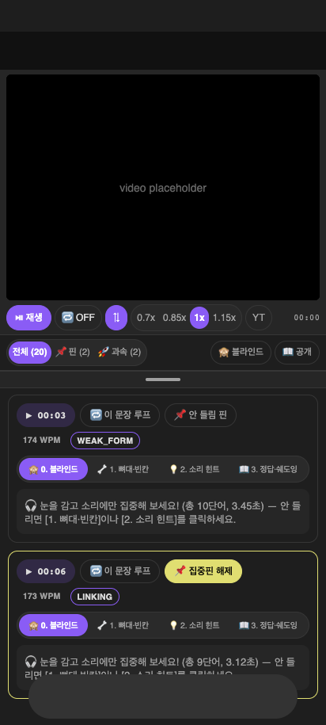
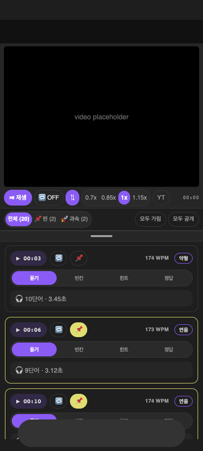
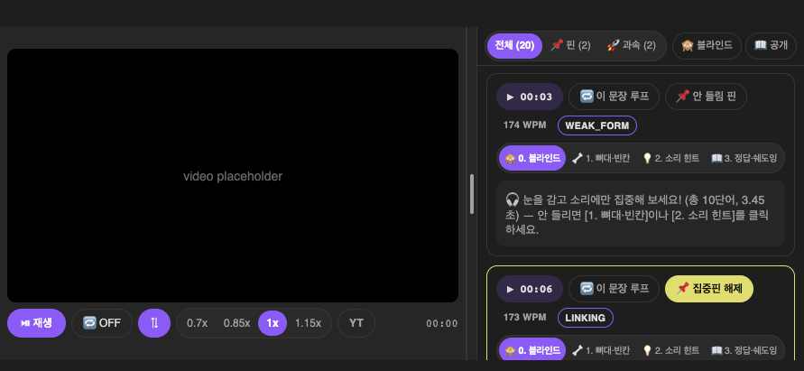
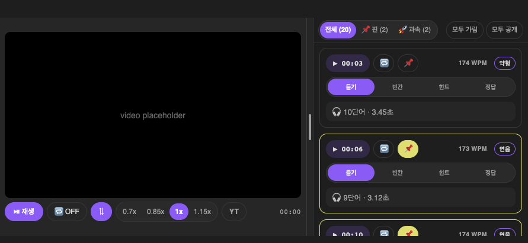

# UI·UX 점검 — 동선·버튼 간결화 (야간 2026-11-22)

> 사람 요청(2026-11-21): 「인터페이스 ux ui 개선고민」 + 「버튼 아이콘 배치 및 표현에 군더더기 없는지, 더 간결할수 있는지 등」.
> 근거: 화면 검사 스크린샷(이번 밤 `node tests/ui/runUiCheck.mjs`, 412×915·891×411), 실기기 사진 `.scratch/inbox/20261121-224719-472.jpg`(439장 영상), 코드 `파일:줄`.
> **화면은 바꾸지 않았다.** 시안은 글자·CSS만 바꾼 사본(worktree)으로 찍은 것이고, 구현 여부는 사람 결정 → `specs/SPEC_028_CARD_DECLUTTER.md` DRAFT.

## 1. 한 바퀴 동선 (모바일)

| 단계 | 지금 | 누르는 횟수 | 문제 |
|---|---|---|---|
| 노트 만들기 | 리본 아이콘(`src/main.ts:158`) 또는 빈 화면 「➕ 유튜브 URL로 새 리스닝 노트 만들기」(`src/ui/EarCoachView.ts:157`) → URL 붙여넣기 | 3~4 | 명령 팔레트 경로는 사람이 못 찾음(메모리). 빈 화면 버튼이 유일한 화면 안 입구 — 이건 좋음 |
| 듣기 | 카드 「▶ 00:03」 또는 플레이어 「⏯ 재생」 | 1 | 문제 없음 |
| 반복 | 카드 「🔁 이 문장 루프」 또는 플레이어 「🔁 OFF」 순환 | 1 | **같은 일 두 곳, 다른 말**(아래 3절) |
| 단계 올리기 | 카드 단계 막대 0→1→2→3 | 1/단계 | 단계 0 안내문이 **카드마다 2~3줄**(`SegmentCard.ts:190`) — 같은 문장이 439번 |
| 사전 | 3단계에서 낱말 탭 → 창 | 2(3단계 + 탭) | 0~2단계에선 낱말을 못 누름(블라인드 의도상 맞음) |
| Anki | 사전 창 「➕ Anki」 | 1 | 문제 없음. 결과 문구가 버튼 아래 작은 글자 |

화면 밀도: 세로에서 목록 영역 402px에 카드 **약 2장**(카드 간격 ≈198px → 402/198 ≈ 2.0). 카드 하나에 버튼 7개(시각·루프·핀·단계 4) + 배지 2~3개 + 안내 2~3줄.

## 2. 버튼 전수 목록 (모바일 기준)

| 위치 | 글자 | 누르면 | 코드 |
|---|---|---|---|
| 플레이어 | ⏯ 재생 | 재생/멈춤 토글 | `PlayerBar.ts:125` |
| 플레이어 | 🔁 OFF / 🔂 ∞ / 🔂 ×N | 반복 모드 순환(SPEC_023) | `PlayerBar.ts:132`, `loopControl.ts:20` |
| 플레이어 | ⇅ | 카드 따라가기(aria-label 있음) | `PlayerBar.ts:140` |
| 플레이어 | 0.7x 0.85x 1x 1.15x | 배속 | `PlayerBar.ts:162` |
| 플레이어 | YT | 유튜브 오버레이(aria-label 있음) | `PlayerBar.ts:176` |
| 플레이어 | 00:00 | (글자, 버튼 아님) | `PlayerBar.ts:186` |
| 툴바 | 전체 (N) / 📌 핀 (N) / 🚀 과속 (N) | 목록 거르기 | `EarCoachView.ts:670` |
| 툴바 | 🙈 블라인드 | 모든 카드 단계 0 | `EarCoachView.ts:700` |
| 툴바 | 📖 공개 | 모든 카드 단계 3 | `EarCoachView.ts:706` |
| 카드 | ▶ 00:03 | 이 문장 재생 | `SegmentCard.ts:72` |
| 카드 | 🔁 이 문장 루프 / 🔁 루프 중 (해제) | 이 문장 반복 토글 | `SegmentCard.ts:81` |
| 카드 | 📌 안 들림 핀 / 📌 집중핀 해제 | 핀 토글 | `SegmentCard.ts:89` |
| 카드 | 🙈 0. 블라인드 · 🦴 1. 뼈대·빈칸 · 💡 2. 소리 힌트 · 📖 3. 정답·쉐도잉 | 단계 | `SegmentCard.ts:117` |
| 카드(배지) | 195 WPM 🚀과속 · LINKING · SPEED_SPIKE | (글자) | `SegmentCard.ts:100` |
| 사전 창 | 🔊 발음 · ➕ Anki | 발음 재생 · 카드 저장 | `DictionaryModal.ts:104,125` |
| 데스크톱만 | 🎙️ 1:1 사운드 해부, 🤖 agy AI…, 🎙️ 왜 이렇게 들리는지… | agy CLI | 모바일엔 안 보임 — 이번 범위 밖 |

## 3. 찾은 군더더기

1. **같은 뜻 다른 말**
   - 반복: 카드 「루프」 ↔ 플레이어 「반복」(데스크톱 `🔁 반복: OFF`, `loopControl.ts:25`), 아이콘도 🔁/🔂 혼용.
   - 핀: 「안 들림 핀」 ↔ 켜진 뒤 「집중핀 해제」 ↔ 툴바 「핀」. 켜진 상태는 이미 노란 배경으로 보임.
   - 블라인드: 카드 단계 0 「블라인드」 ↔ 툴바 「블라인드」(모든 카드를 단계 0으로). 같은 낱말이 범위만 달라 헷갈림.
2. **아이콘+글자 중복**: 「🔁 이 문장 루프」「📌 안 들림 핀」「🙈 0. 블라인드」 — 아이콘·번호·낱말이 셋 다 같은 걸 말함. 단계 막대는 번호와 아이콘 둘 중 하나면 충분.
3. **같은 정보 두 번**: 과속 문장은 「195 WPM 🚀과속」(빨간 배지) + 「SPEED_SPIKE」 배지(`transcriptProcessor.ts:103`가 함정 목록에도 넣음).
4. **영어 대문자 내부 이름 노출**: `LINKING`·`WEAK_FORM`·`SPEED_SPIKE` 배지(`SegmentCard.ts:110`)가 코드 상수 그대로 — 학습자 말로 「연음·약형·탈락·플랩 t·구어」가 짧고 뜻이 섬.
5. **매 카드 반복되는 안내문**: 단계 0 「🎧 눈을 감고 소리에만 집중해 보세요! (총 N단어, N초) — 안 들리면 [1. 뼈대·빈칸]이나 [2. 소리 힌트]를 클릭하세요.」 — 처음 한 번 배우면 끝나는 설명. 쓸모 있는 정보는 「N단어 · N초」뿐. 모바일에서 「클릭」도 어색.
6. **과속 거르기가 거르지 못함**: 실기기 439장 중 과속 312장(71%) — 기준이 고정 175 WPM(`src/types/settings.ts:51`). 빠른 화자 영상에선 필터 의미가 없음. 영상 안 상대 기준(예: 상위 20%)이 더 맞음(동작 변경 → 사람 결정).
7. **뜻이 안 서는 짧은 글자**: 「YT」「⇅」는 aria-label이 있지만 눈으로는 뜻이 안 섬. 「🔁 OFF」의 OFF는 꺼진 상태를 글자로 말함 — 흐린 색만으로 충분.
8. **이모지 아이콘**: 기기마다 그림이 달라지고(실기기 Samsung 이모지는 색이 진함) 버튼마다 색이 튐. Obsidian 내장 Lucide 아이콘(`setIcon`)은 단색·테마 색을 따름.

## 4. 지금 → 제안

| # | 지금 | 제안 | 효과 | 노력 |
|---|---|---|---|---|
| A | 🔁 이 문장 루프 / 🔁 루프 중 (해제) | 🔁 아이콘만(켜지면 🔂 + 주황), aria-label 「이 문장 반복」 | 카드 머리 한 줄로 | 작음 |
| B | 📌 안 들림 핀 / 📌 집중핀 해제 | 📌 아이콘만(켜지면 노랑), aria-label 「안 들림 핀」 | 말 하나로 통일 | 작음 |
| C | 🙈 0. 블라인드 … 📖 3. 정답·쉐도잉 | 듣기 · 빈칸 · 힌트 · 정답 | 단계 막대 글자 절반, 「블라인드」 충돌 없앰 | 작음 |
| D | 단계 0 안내 2~3줄 | 「🎧 10단어 · 3.45초」 한 줄 (설명은 첫 실행 한 번 또는 설정 화면) | 카드 높이 줄임(A~F 합쳐 −50px) | 작음 |
| E | LINKING·WEAK_FORM… | 연음·약형·탈락·플랩 t·구어, SPEED_SPIKE 배지 빼기(WPM 배지가 이미 말함) | 배지가 WPM 옆 한 줄에 들어감 | 작음 |
| F | 툴바 🙈 블라인드 / 📖 공개 | 모두 가림 / 모두 공개 | 범위가 글자에 드러남 | 작음 |
| G | 반복 말 「루프」/「반복」 | 「반복」으로 통일(카드·플레이어·데스크톱) | 일관 | 작음 |
| H | 고정 175 WPM 과속 | 영상 안 상위 N%(또는 중앙값 +X) | 과속 필터가 다시 거름 | 중간(동작·시험) |
| I | 이모지 아이콘 | Lucide `setIcon` 단색 아이콘 | 색 소음 줄임, 테마 따라감 | 중간(전 버튼) |
| J | 「YT」「⇅」 | 그대로 두되 길게 누르면 aria-label 말풍선(Obsidian `setTooltip`) | 발견성 | 작음 |

**추린 것(효과 큼 × 노력 작음): A·B·C·D·E·F** → 한 SPEC(`SPEC_028` DRAFT). G는 데스크톱 글자까지라 함께 넣을 수 있음. H·I는 따로(동작·전체 아이콘 교체라 사람 결정 먼저).

## 5. 시안 — 글자·CSS만 바꾼 사본으로 찍음

A~F를 사본에 넣고 같은 화면 검사로 찍었다(겹침 검사 통과, 사전·Anki 검사는 단계 버튼 글자 「3.」을 찾느라 시안에선 실패 — 구현 때 검사 선택자를 글자 대신 `data-step`으로).

| | 지금 | 시안 |
|---|---|---|
| 세로 |  |  |
| 가로 |  |  |

- 세로 목록에 들어가는 카드: **약 2.0장 → 약 2.7장**(카드 간격 ≈198px → ≈147px, −26%; 스크린샷에서 잰 값. 셋째 카드는 아래 내비바에 일부 가림).
- 카드 머리가 한 줄(▶ 시각 · 🔁 · 📌 … WPM · 함정)로 접힘. 핀 켜진 카드는 노란 테두리 + 노란 📌로 여전히 구분됨.
- 아이콘만 버튼(🔁·📌)은 30×30 — 손가락 목표 44px 권고보다 작음. 구현 때 높이 36px 이상 검토(⏳ 실기기 감각).
- 시안 사본 diff: `.scratch/ui-mock.diff`(git 밖).

## 6. 사람에게 물을 것

- A·B 아이콘만으로 충분한가, 아니면 짧은 글자(「반복」「핀」)를 남길까 — 취향.
- C 단계 이름: 「듣기 · 빈칸 · 힌트 · 정답」(추천) vs 번호만 「0 · 1 · 2 · 3」 vs 지금 그대로.
- D 안내문을 없애도 되는가(첫 실행 한 번만 보이기 추천).
- H 과속 기준 바꾸기 — 따로 SPEC으로 할지.
